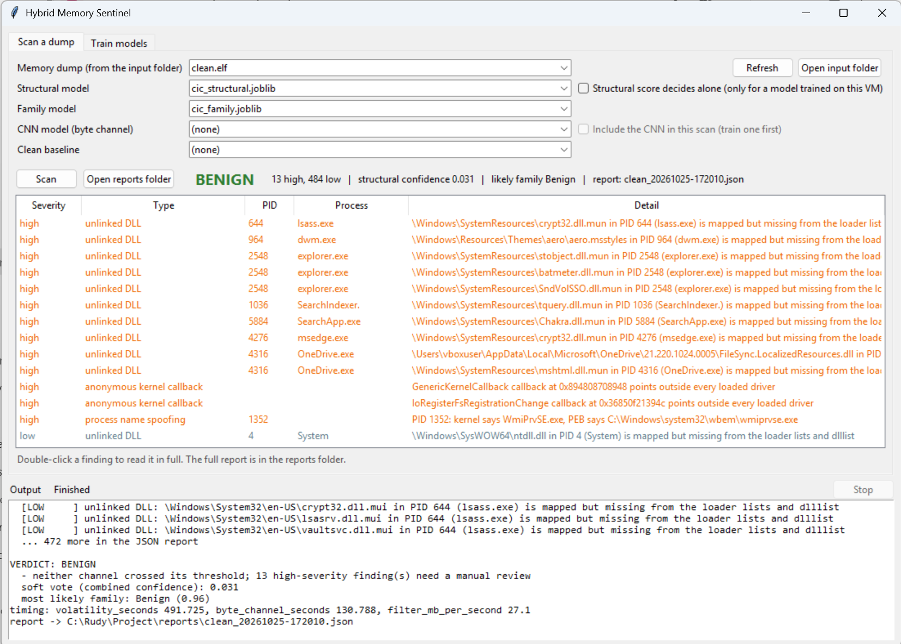
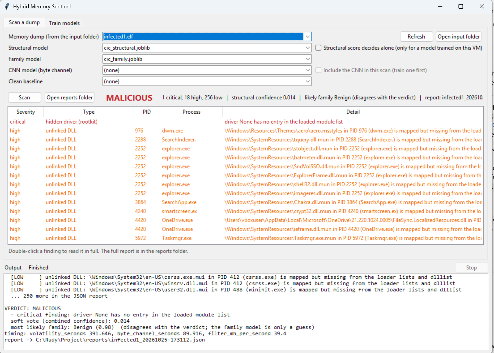

# Hybrid Memory Sentinel (HMS)

Malware detection using memory analysis.

HMS reads a raw memory dump of a Windows VM, taken from outside the VM by the hypervisor, and reports every sign of malware it finds. It's aimed at malware that hides from tools running inside the infected machine: processes unlinked from the process list, DLLs removed from the loader lists, hidden drivers, hollowed processes and injected code. Malware inside the guest can't change a dump the hypervisor writes, so these tricks show up as contradictions between different views of the same memory.

```
                         memory dump
             +---------------+---------------+
   structural channel                 byte channel
   Volatility 3 (18 plugins)          4 KB pages -> zero filter -> baseline dedup
   -> hiding checks (findings)        -> entropy / instruction validation
   -> AGR + UDR + 55 features         -> 1D-CNN (calibrated) per page
   -> XGBoost / LightGBM
             +---------------+---------------+
                       fusion engine
   MALICIOUS if any critical finding (hidden process, reflective DLL,
             injected PE, hidden driver, hollowing, ghosting)
          or flagged pages / candidate pages >= 20%
          or structural confidence >= 0.90 and the CNN or a finding agrees
   SUSPICIOUS if structural confidence >= 0.90 with nothing agreeing
   soft vote = mean of the channels' probabilities (combined confidence)
```

The project ships two ready-to-use models trained on the public CIC-MalMem-2022 dataset: `models\cic_structural.joblib` (malware or benign) and `models\cic_family.joblib` (Benign, Ransomware, Spyware or Trojan). You can scan a dump with them right away, and retrain or add models from your own data.

> **The bundled structural model does not work as a detector.** It scores 100% on CIC-MalMem-2022 because it learned a shortcut in that dataset: the number of Windows services alone separates benign rows (mostly 392 or 395 services) from malware rows (mostly 389). Volatility 3 counts about 1,400 services on the VM tested here, and the model scored both the clean and the infected dump close to zero. Verdicts on real dumps come from the hiding checks. The cutoffs each channel uses to call a dump malicious are also design settings that haven't been tuned on real output yet. See [Status and limits](#status-and-limits).

**Only load model files (`.joblib`) from people you trust, because loading one can run code on your computer.**

**Contents**

1. [Set up the software](#1-set-up-the-software)
2. [Scan a memory dump](#2-scan-a-memory-dump)
3. [Set up a VM to collect memory dumps](#3-set-up-a-vm-to-collect-memory-dumps)
4. [Train models from a CSV dataset](#4-train-models-from-a-csv-dataset)
5. [Train the CNN from your own dumps](#5-train-the-cnn-from-your-own-dumps)

[Results on real dumps](#results-on-real-dumps) · [Folders](#folders) · [Citation](#citation) · [Status and limits](#status-and-limits)

All commands are for Windows and run from the project folder unless a step says otherwise. `C:\Evidence` is an example location for memory dumps; any folder works.

---

## 1. Set up the software

**You need:** Windows 10 or 11, 64-bit [Python](https://www.python.org/downloads/) 3.10 or newer (tick "Add python.exe to PATH" and keep "tcl/tk" selected in the installer, the window needs it), and about 3 GB of free disk space for the libraries.

1.1. Open a terminal (PowerShell or Command Prompt) in the project folder.

```
cd path\to\Project
```

1.2. Create and activate a virtual environment, so the libraries stay inside the project.

```
python -m venv .venv
.venv\Scripts\activate
```

The prompt now starts with `(.venv)`. Run the activate line again whenever you open a new terminal. If PowerShell refuses to run the script, run `Set-ExecutionPolicy -Scope CurrentUser RemoteSigned` once, or use Command Prompt.

1.3. Install the libraries.

```
pip install -r requirements.txt
pip install -r requirements-cnn.txt
```

`requirements.txt` lists what each library is for and the versions HMS was tested with. The second line installs `torch`, the largest download, which is only needed for the CNN (section 5). It is in its own file so that if it fails to install on your computer, everything else is already installed and works.

1.4. Check the install.

```
python -m pytest
```

Expect `56 passed` (or `55 passed, 1 skipped` without torch). The tests use generated data: they show the code works, not how well it detects malware.

1.5. Open the HMS window.

Double-click `run_gui.bat`, or run `python -m hms gui`. If the window can't start (for example the libraries aren't installed yet), `run_gui.bat` shows the error instead of doing nothing. For the command-line version, run `python -m hms --help`.

---

## 2. Scan a memory dump

You need a raw memory dump of a Windows machine: a VirtualBox `.elf`, a VMware `.vmem` (with its `.vmss` or `.vmsn` file next to it), or a `.raw` / `.mem` image. Section 3 shows how to capture one from a VM. A dump is only data; scanning it does not run anything inside it.

### With the window

1. Copy the dump into the `input\` folder and press **Refresh** in the **Scan a dump** tab.
2. Pick the models. The bundled `cic_structural.joblib` and `cic_family.joblib` are selected by default. Choose "(none: hiding checks only)" to skip the structural model. A clean baseline and a CNN can be picked too once you have made them (sections 3 and 5); tick **Include the CNN in this scan** to use the CNN. Leave **Structural score decides alone** unticked unless the structural model was trained on dumps of this VM.
3. Press **Scan**. The verdict (BENIGN, SUSPICIOUS, MALICIOUS or INCONCLUSIVE) and every finding appear in the window, most severe first. **Stop** ends the scan, including a running Volatility. Double-click a finding to read it in full. The full JSON report is saved in `reports\`.

### From the command line

```
python -m hms scan --dump C:\Evidence\vm.elf --structural models\cic_structural.joblib --report reports\vm.json
```

The hiding checks need no model. Add any of these:

| Option | Adds |
|---|---|
| `--structural models\cic_structural.joblib` | the boosted-tree confidence from the 55 features + AGR + UDR (the bundled model) |
| `--family models\cic_family.joblib` | the most likely family: Ransomware, Spyware or Trojan (the bundled family model; it doesn't change the verdict) |
| `--baseline models\baseline.npy` | drops pages identical to a clean dump of the same VM (section 3.6) |
| `--cnn models\cnn.pt` | the CNN score for each candidate page (section 5) |

Exit codes: 0 BENIGN, 1 MALICIOUS, 3 INCONCLUSIVE (nothing could be checked, or no model ran and the hiding checks need a manual look), 4 SUSPICIOUS, 2 usage error (including a file that doesn't exist; every input is checked before Volatility starts), 5 HMS failed (the error is printed; a crash never looks like a detection). For `scan --features` without `--dump`, the exit code is 1 if any row is flagged and 0 otherwise.

`--structural-decides` lets a structural score of 0.90 or more make the dump MALICIOUS on its own (see below). Use it only with a model trained on dumps of the VM you are scanning.

**First scan of a dump:** Volatility downloads Windows symbol files from Microsoft, so the computer running HMS needs internet then (the VM does not). The plugin output is cached in a `<dump name>_vol\` folder next to the dump, so later scans of the same dump are quick. A `source.json` there records the dump's name, size, modification time and a hash of three 1 MB samples; if any of these changes (a new capture saved under the same name, for example), the old output is discarded and Volatility runs again. Two dumps with the same name but different extensions (`vm.raw`, `vm.mem`) get separate folders. A cache with no record (made by hand or by an older version) is only reused if it is newer than the dump; if in doubt, delete the `_vol` folder. A cache file that was cut short or damaged is run again, and a check that failed for any reason other than a missing plugin is retried on the next scan. With `--features` and `--dump` together, the score comes from the table row but the hiding checks still run on the dump.

### Reading the result

The verdict is **MALICIOUS** if any finding is critical, or 20% or more of the candidate pages are classified malicious by the CNN, or the structural confidence is 0.90 or higher **and** something independent agrees: the CNN, a critical finding, or one of these high findings: hidden service, process hollowing, process ghosting, orphan kernel thread or anonymous kernel callback. Other findings (unlinked DLLs, name spoofing, plain injected code) don't count, because a clean VM can produce them too; for example Explorer maps programs in Downloads or AppData to read their icons, which shows up as unlinked DLLs.

It is **SUSPICIOUS** when the structural confidence is 0.90 or higher but nothing else agrees. The bundled model was trained on the CIC-MalMem-2022 VMs and relies almost entirely on two service counts, so on a different VM a high score can just mean the VM is set up differently. Look at the findings, or train a model on dumps of your own VM and tick **Structural score decides alone** (`--structural-decides`).

Otherwise it is **BENIGN**. With "(none: hiding checks only)" a dump is BENIGN when the hiding checks ran and found nothing critical and none of the high findings listed above; those make it INCONCLUSIVE. Whatever the verdict, any high findings are mentioned in the reasons as needing a manual review. It is also **INCONCLUSIVE** if nothing could be checked.

| Finding | Severity | Meaning |
|---|---|---|
| hidden process (DKOM) | critical | running process found by pool scan, unlinked from the process list (pslist vs psscan) |
| hidden process (pool scan evaded) | critical | process missing from both pslist and psscan that still has at least one thread with no exit time (thread scan); if all its threads have exited it is high |
| reflectively loaded module | critical | image mapped in a process, missing from all loader lists, no file |
| injected PE image | critical | executable private memory starting with an MZ header |
| hidden driver (rootkit) | critical | driver object with no loaded-module entry |
| process hollowing | critical/high | process image replaced in memory |
| process ghosting | critical | process running from a file marked for deletion |
| unlinked DLL, hidden service, name spoofing, orphan kernel thread, anonymous kernel callback | high | strong hiding indicators |
| injected code (malfind), suspicious thread | medium | common in malware, also produced by JIT compilers |
| anything matching a known benign cause | low | listed with the reason |

Normal Windows look-alikes (exiting processes, minimal processes like Registry and MemCompression with no running threads, 32-bit DLLs in WoW64 processes, language and font files, JIT memory in browsers, PowerShell, .NET and antivirus) are reported as low with the reason, so they never decide the verdict. Because malware can use any name, and a rootkit can rewrite a process's PID and name, neither a name match nor an odd PID or name ever lowers a running process unlinked from the process list, and a name match never lowers an injected PE image: those stay critical, with the possible harmless cause shown as a note to check. The lists are in `hms\allowlist.py`. A check whose Volatility plugin is missing is skipped and listed under "checks not run". If a hiding check can't run (a plugin missing from your Volatility), it is listed under "checks not run" and mentioned in the verdict; with no model score, a missing hidden-driver, hollowing or ghosting check gives INCONCLUSIVE instead of BENIGN.

The JSON report contains:

- `verdict`: label, reasons, structural score, flagged-page ratio, soft vote.
- `findings`: every suspicious item, most severe first, with `severity`, `type`, `pid`, `process`, `detail`, and `benign_explanation` when a harmless cause matches.
- `evidence`: AGR, UDR, hidden processes, injected regions, unlinked DLLs, checks that couldn't run.
- `suspicious_pages`: file offsets of the top pages, with CNN probability and entropy.
- `flagged_pages`: every page the CNN flagged, highest score first (only with a CNN).
- the dump's `sha256`, `filter` statistics, `timing`, the 55 features and the family guess (or `family_error` if the family model couldn't be used; that never stops a scan).

The report is strict JSON: features Volatility 3 can't provide are `null`.

### Other scan commands

```
python -m hms extract C:\Evidence\vm.elf                   Volatility step only: features CSV + evidence JSON
python -m hms filter C:\Evidence\vm.elf --baseline models\baseline.npy
                                                           how many pages the filter keeps
python -m hms temporal C:\Evidence\t0.elf C:\Evidence\t60.elf --report reports\temporal.json
                                                           compare two dumps taken 60 s apart
python -m hms scan --features dataset\Obfuscated-MalMem2022.csv --structural models\cic_structural.joblib
                                                           score every row of a feature table
```

`extract` writes `vm.features.csv` (the 55 CIC-MalMem-2022 features), `vm.features.evidence.json` (every finding) and the `vm_vol\` plugin cache. `temporal` shows which processes started or ended and which injected regions stayed, vanished or appeared between two dumps: injected code that vanishes within 60 seconds can be missed by a single snapshot.

---

## 3. Set up a VM to collect memory dumps

Use this to get dumps to scan (section 2) and to build your own training data (sections 4 and 5). The malware runs **inside** the VM; HMS runs **outside** it, on a dump the hypervisor writes. HMS is never installed in the infected machine.

> **Warning.** Running live malware is risky. A mistake in isolation can put your computer and everything on your network at risk. Do a complete dry run of steps 3.1–3.9 with a harmless program (for example Notepad) in place of the malware first. The hypervisor commands below come from the VirtualBox and VMware documentation; check them on a harmless VM before relying on them.

**3.1. Build the victim VM.**
Install VirtualBox or VMware Workstation. Create a Windows 10 guest with 2 GB of RAM (less RAM means smaller dumps and faster scans). Don't sign in with a personal account or store personal files in it.

**3.2. Prepare the guest.**
Install a few ordinary programs (a browser, a PDF reader) so benign dumps look like a real workstation. Turn off Windows Defender real-time protection in the guest, otherwise it deletes the sample before it runs. Copy the malware sample into the guest while it is still a password-protected archive; don't extract it yet. **Never extract a malware sample on the host.**

**3.3. Isolate the guest.** In the VM settings:

- Network adapter: host-only, or disconnected.
- Shared folders: removed.
- Shared clipboard and drag and drop: disabled.
- USB passthrough: disabled.

Confirm from inside the guest that it can't reach the internet or your home network.

**3.4. Take the clean snapshot** with the guest running, logged in and idle. Every experiment starts from it.

- VirtualBox: `VBoxManage snapshot "VictimVM" take clean`
- VMware: VM menu > Snapshot > Take Snapshot, name it "clean"

**3.5. Capture a clean (baseline) dump.** Always from the host, never from inside the guest.

- VirtualBox: `VBoxManage debugvm "VictimVM" dumpvmcore --filename=C:\Evidence\clean.elf`
- VMware: take a snapshot or suspend the VM. Copy the `.vmem` file from the VM's folder to `C:\Evidence\clean.vmem`, and copy the `.vmss` or `.vmsn` file with the same name next to it (Volatility needs it to read the `.vmem`).

Keep dumps in a folder outside the project, and copy them into `input\`, `CNNDataSet\` or wherever they're needed.

**3.6. Build the clean baseline (optional, recommended).** It hashes every non-zero page of the clean dump, so later scans of the same VM skip unchanged pages.

- Window: copy `clean.elf` into `input\`, pick it in the Scan tab's dump list, then press **Build baseline** in the Train tab. It is saved as `models\baseline_<dump name>.npy`.
- Command: `python -m hms baseline C:\Evidence\clean.elf -o models\baseline.npy`

**3.7. Detonate the sample.** Inside the guest, extract the sample and run it. Leave it running for one to two minutes and note the start time.

**3.8. Capture the infected dump** the same way as 3.5, with a new name, e.g. `C:\Evidence\infected_01.elf`. For the temporal check, take a second dump 60 seconds later (`infected_01_t60.elf`).

Always capture the baseline and the infected dumps with the same hypervisor and the same method: a VirtualBox dump has a file header that a VMware dump doesn't, so mixing the two breaks the page comparison.

**3.9. Revert the VM** after every sample, before anything else.

- VirtualBox: `VBoxManage controlvm "VictimVM" poweroff`, then `VBoxManage snapshot "VictimVM" restore clean`
- VMware: VM menu > Snapshot > Revert to Snapshot > clean

**3.10. Record the evidence.** Reading a dump on the host doesn't run the malware. Record its hash so you can show it wasn't altered, and never edit a dump (everything HMS produces is a separate file):

```
certutil -hashfile C:\Evidence\infected_01.elf SHA256
```

**3.11. Collect more dumps.** Repeat 3.7–3.9 for each sample. For benign dumps, revert to clean, open normal programs, and capture. These dumps feed section 4 (your own feature table) and section 5 (the CNN).

### Safety checklist

Before every detonation:

- [ ] Guest network is host-only or disconnected
- [ ] Shared folders, clipboard, drag and drop and USB are disabled
- [ ] A clean snapshot exists
- [ ] The sample has only ever been extracted inside the guest
- [ ] Nothing personal is stored or signed in inside the guest
- [ ] You know the command to revert the VM

After every detonation:

- [ ] Dump captured from the host
- [ ] VM reverted to the clean snapshot
- [ ] Dump hash recorded

---

## 4. Train models from a CSV dataset

The structural model (malware or benign) and the family model (Benign, Ransomware, Spyware, Trojan) train on a feature table: one row per memory dump, in the CIC-MalMem-2022 layout. You don't need this to scan; both bundled models are already trained. Use it to reproduce them, try other settings, or train on your own dumps.

**4.1. Get a feature table** and put the `.csv` in `dataset\`. Either:

- **CIC-MalMem-2022** (no malware touches your computer): download `Obfuscated-MalMem2022.csv` from <https://www.unb.ca/cic/datasets/malmem-2022.html>. It holds features that researchers extracted from 58,596 memory dumps with Volatility.
- **Your own dumps** from section 3: put them in `CNNDataSet\benign` and `CNNDataSet\malicious` (see 5.1), then press **Build table** in the Train tab, or run `python -m hms build-table`. It runs Volatility on every dump and writes `dataset\my_dumps.csv`. The first run is slow.

A table needs the 55 CIC-MalMem-2022 feature columns plus `Class` (Benign or Malware) and `Category` (family-sample-number, e.g. `Ransomware-Ako-abc-1`).

**4.2. Train with the window.** In the **Train models** tab, under "Structural and family models":

1. Pick the feature table (press Refresh if it isn't listed).
2. Pick the model (XGBoost or LightGBM) and the split (see below). The family model always uses XGBoost and only takes the split setting.
3. Optionally set "Keep best K features" (e.g. 10, ANOVA feature selection) and tick "Also compare RF, DT, KNN, LR, SVM".
4. Type a name under "Save as" and press **Train structural model** or **Train family model**. The window won't overwrite the bundled models, and asks before replacing a model you trained earlier.

Progress and results appear in the Output pane. The new model is saved in `models\` and shows up in the Scan tab's lists.

**4.3. Or train from the command line.**

```
python -m hms train-structural --csv dataset\Obfuscated-MalMem2022.csv --baselines --out models\my_structural.joblib
python -m hms train-family --csv dataset\Obfuscated-MalMem2022.csv --out models\family_my_model.joblib
```

`train-structural` options: `--split group|random`, `--model xgboost|lightgbm`, `--select K` (keep the K best features), `--baselines` (also train and score Random Forest, Decision Tree, KNN, Logistic Regression and SVM for comparison), `--seed`.

It prints accuracy, precision, recall, F1, false-positive rate and AUC, then recall per malware family, and saves the model plus a `.metrics.json` with every number.

**Split:** the default **group** split keeps all dumps of one malware sample on the same side of the train/test split, which is the stricter test. **random** is the row-level split most papers use. Report both and label which is which.

**What to expect on CIC-MalMem-2022:** about 100% for malware vs benign (the table is easy to separate) and 86–88% for the family model.

Family models must have "family" in their file name so the window lists them as family models.

---

## 5. Train the CNN from your own dumps

The CNN scores each 4 KB page of a dump for malicious code. No public dataset of raw dumps exists, so it trains on dumps you capture with section 3. It needs `torch` (`requirements-cnn.txt`, section 1.3).

**5.1. Fill the training folders.**

```
CNNDataSet\benign\       dumps of the VM with only normal programs running
CNNDataSet\malicious\    dumps taken after running a malware sample
                         (optionally one subfolder per family, e.g. malicious\Ransomware\)
```

Put at least two dumps in each folder, all captured the same way from the same VM. More samples and more families give a more believable result.

**5.2. Train with the window.** In the **Train models** tab, under "CNN byte model", set the number of epochs (5 is a good start) and press **Train CNN**. The model is saved in `models\` under the "Save as" name from the section above (e.g. `models\my_model.pt`), and the **Include the CNN in this scan** box in the Scan tab becomes available.

**5.3. Or train from the command line.**

```
python -m hms train-cnn --benign CNNDataSet\benign --malicious CNNDataSet\malicious --epochs 5
```

Options: `--out` (default `models\cnn.pt`), `--max-pages` (pages sampled per file, default 512), `--seed`.

Validation uses whole files the model never trained on. After training, HMS calibrates the output with temperature scaling. If the trained model flags more than 10% of the held-out clean pages, or finds fewer than half of the malicious ones, training ends with a **WARNING** line in the Output pane: train for more epochs or add more dumps before relying on it.

**5.4. Check it.** Scan the clean dump from 3.5 with every model:

```
python -m hms scan --dump C:\Evidence\clean.elf --structural models\cic_structural.joblib --baseline models\baseline.npy --cnn models\cnn.pt --report reports\clean.json
```

It should come out BENIGN with no critical findings. If it doesn't, look at which finding fired. A critical finding on a clean VM is a false positive. For medium and high findings, adding the harmless program to `hms\allowlist.py` lowers them; a running unlinked process or an injected PE image stays critical whatever the allowlist says, so look at it by hand and report it as a false positive if it is one. A SUSPICIOUS verdict (structural score of 0.90 or more with nothing else agreeing) means the classifier is reacting to your VM being different from the CIC-MalMem-2022 machines.

**Limitation:** every page of an infected dump is labelled malicious, even though most of those pages are ordinary Windows memory. Labelling only the injected regions would give a cleaner training set.

---

## Results on real dumps

HMS was run on real memory dumps of a Windows 10 VirtualBox guest (about 3.3 GB each, captured from the host with `VBoxManage debugvm ... dumpvmcore`). Two are shown here: a clean dump, and an infected dump taken after running a malware sample. Each scan used the bundled `cic_structural.joblib` and `cic_family.joblib`, with no CNN and no clean baseline.

| Dump | Verdict | Findings | Structural confidence | Family guess | Volatility time |
|---|---|---|---|---|---|
| `clean.elf` | **BENIGN** | 0 critical, 13 high, 484 low | 0.031 | Benign (0.96) | 492 s |
| `infected1.elf` | **MALICIOUS** | 1 critical, 18 high, 256 low | 0.014 | Benign (0.98) | 392 s |

**Clean dump.** HMS returned BENIGN. The 13 high findings are resource files (`.mun`, `.msstyles`) that Explorer, DWM, Search and OneDrive map without loading them as DLLs, two kernel callbacks outside any loaded driver, and one process whose kernel name and PEB path differ only in letter case (`WmiPrvSE.exe` and `wmiprvse.exe`). None of them can make a dump MALICIOUS on their own, so the clean VM produced no false alarm.



**Infected dump.** HMS returned MALICIOUS because of one critical finding: a driver object found by the pool scan that has no entry in the loaded-module list, which is how a rootkit hides a driver. The driver object has no name, so confirm it by hand (for example with `vol -f infected1.elf windows.driverscan`) before calling it a rootkit.



**What this shows.**

- On `infected1.elf` the verdict came from the hiding check (the hidden driver). The structural model's confidence was 0.014 and the family model guessed Benign.
- The high findings are much the same on the clean dump and `infected1.elf`, so on this VM they are background noise rather than signs of infection.
- A full scan of a 3.3 GB dump took about 8 to 10 minutes, most of it in Volatility. Later scans of the same dump reuse the cached plugin output.
- The infected dump was flagged and the clean one gave no false alarm, but two dumps are far too few to give a detection or false-positive rate. Training a CNN and a structural model on dumps of this VM (sections 4 and 5) is the next step.

---

## Folders

```
input\         memory dumps to scan
dataset\       feature tables (.csv) for the structural and family models
CNNDataSet\    your own dumps for the CNN (and for Build table): benign\ and malicious\
models\        the two bundled CIC models (cic_structural.joblib, cic_family.joblib) and any you train
reports\       one JSON report per scan
hms\           the code
tests\         unit tests on generated data
docs\images\   screenshots used in this README
run_gui.bat    opens the window
```

The bundled models were trained on CIC-MalMem-2022 (Canadian Institute for Cybersecurity). The dataset itself isn't included; download it to retrain.

## Citation

The bundled models were trained on CIC-MalMem-2022. The Canadian Institute for Cybersecurity asks that any use of the dataset cite both the dataset and its paper, so if you use the bundled models or the dataset, cite:

> T. Carrier, P. Victor, A. Tekeoglu and A. H. Lashkari, "Detecting Obfuscated Malware using Memory Feature Engineering," in *Proceedings of the 8th International Conference on Information Systems Security and Privacy (ICISSP 2022)*, SciTePress, 2022, pp. 177–188. doi: [10.5220/0010908200003120](https://doi.org/10.5220/0010908200003120).

Dataset: Canadian Institute for Cybersecurity, *CIC-MalMem-2022*, University of New Brunswick, <https://www.unb.ca/cic/datasets/malmem-2022.html>.

```bibtex
@inproceedings{carrier2022malmem,
  author    = {Carrier, Tristan and Victor, Princy and Tekeoglu, Ali and Lashkari, Arash Habibi},
  title     = {Detecting Obfuscated Malware using Memory Feature Engineering},
  booktitle = {Proceedings of the 8th International Conference on Information Systems Security and Privacy (ICISSP)},
  pages     = {177--188},
  year      = {2022},
  publisher = {SciTePress},
  doi       = {10.5220/0010908200003120},
  isbn      = {978-989-758-553-1}
}
```

Memory parsing is done by [Volatility 3](https://github.com/volatilityfoundation/volatility3) from the Volatility Foundation.

## Status and limits

- The structural models score about 100% on CIC-MalMem-2022 because that table is easy to separate; the family model scores 86–88%.
- **The bundled structural model doesn't really work, because of shortcut training.** In CIC-MalMem-2022 the service count (`svcscan.nservices`) alone separates the classes: 28,760 of the 29,298 benign rows have exactly 392 or 395 services, and 27,242 of the 29,298 malware rows have exactly 389. A single cutoff near 390 sorts the table with 99.66% accuracy, and 96% of the model's weight sits on two service counts. The model learned how the dataset's benign and malware dumps were produced, not what malware does. Volatility 3 counts about 1,400 services on the VM scanned here, and the model scored the clean dump 0.031 and the infected dump 0.014. The family model was trained on the same table and guessed Benign for the infected dump. This is known as shortcut learning (Geirhos et al., "Shortcut learning in deep neural networks," *Nature Machine Intelligence* 2, 665–673, 2020).
- **The malware criteria for each channel are design choices, not tuned values.** The structural cutoff (confidence of 0.90 or more), the CNN cutoff (20% or more of candidate pages scoring 0.5 or more), and the list of findings that count as critical were set from the design and from how each hiding technique works. None of them has been optimised or calibrated on real scan output, because there isn't yet a labelled set of real dumps to tune them on. Until they are, treat every verdict as a lead to check by hand.
- HMS has been shown on only two real dumps, one clean and one infected (see [Results on real dumps](#results-on-real-dumps)). That is enough to show it works end to end, not enough to measure accuracy.
- The model was trained on Volatility 2 output. Volatility 3 has no pspcid, session or deskthrd view in psxview, so those columns are approximated or left empty (details in `hms\extract.py`).
- The CNN needs your own clean and infected dumps to train.
- There is no live hypervisor introspection (LibVMI); HMS reads saved dumps of Windows guests.

## License

MIT, see `LICENSE`. Copyright (c) 2026 Rudrarka Nath. You may use, copy, modify and redistribute HMS, including commercially, as long as the copyright notice and license text stay with every copy.

The CIC-MalMem-2022 dataset is not part of this project and keeps its own terms; see the dataset's page.
